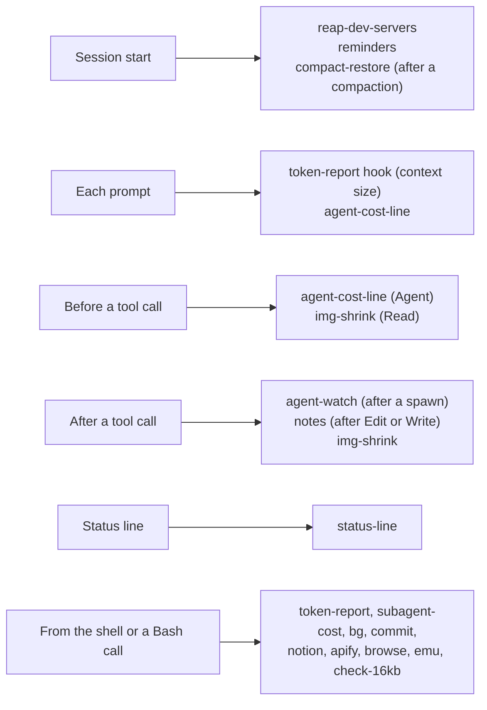

# claude-code-session-toolkit

Know what Claude Code costs per session and per subagent, and cut it. These are 21 small tools from my daily Claude Code setup, one folder per tool, each installable on its own.

## What they showed on my own sessions

I measure each change to my setup on my session transcripts. A few results:

- Subagents used 65% of my input tokens (`token-report`).
- In one session, 221 subagent wake-ups made up 70% of the main thread's tokens. `agent-cost-line` now warns, with a token estimate, when one prompt starts its 3rd, 5th, 10th, 15th and 20th subagent.
- Compacting at 300k tokens instead of 400k would have cut main-thread tokens by up to 32%, and compacting subagents at 200k up to 30% (a replay of my transcripts, so upper bounds). `compact-restore` puts the working state back after each compaction.
- My rules files shrank by 44% across 10 repositories once narrative moved into notes that load on demand. `notes` hands back any `CLAUDE.md`, index or note over 40,000 bytes after each edit, and its pre-commit hook checks them again.

## The tools

**See what a session costs**

| Tool | What it does |
| --- | --- |
| [`token-report/`](token-report/) | Shows where tokens go from your session transcripts: by project, model, session and subagent. Includes `subagent-cost` and an optional per-prompt hook. |
| [`status-line/`](status-line/) | A Claude Code status line: model, context against the compact window, session time, cost, 5h and 7d plan limits with pace, git state, running subagents. `statusline-price-fit` re-measures its subagent prices. |
| [`agent-cost-line/`](agent-cost-line/) | A hook that warns with an estimated token total when one prompt starts its 3rd, 5th, 10th, 15th and 20th subagent. |
| [`agent-watch/`](agent-watch/) | Wakes the main thread when a background subagent is stuck. A script, a hook and a test. |

**Keep the context small**

| Tool | What it does |
| --- | --- |
| [`notes/`](notes/) | Keeps narrative docs as one file per topic behind an index, with size limits, an edit hook and a pre-commit hook installer. |
| [`compact-restore/`](compact-restore/) | After compaction, restores the scratchpad state file, edited files, commits and your last prompts. |
| [`img-shrink/`](img-shrink/) | A Read hook that shows Claude large screenshots shrunk to 1200 px, with `img-full` for the original. macOS only. |
| [`worker-agent/`](worker-agent/) | A subagent definition for build and fix work: Sonnet by default, compacts at 200k, trimmed tool list, short working rules. |

**Session hygiene**

| Tool | What it does |
| --- | --- |
| [`bg/`](bg/) | Starts background processes with PID files and logs in the session scratchpad, and stops them by name. |
| [`reap-dev-servers/`](reap-dev-servers/) | Stops Metro, `next dev` and jest processes that sessions left running, at session start. |
| [`reminders/`](reminders/) | A SessionStart hook that shows dated reminders from a TSV file, per folder. |
| [`commit/`](commit/) | A path-scoped `git commit` for shared trees: stages only the paths you name, adds the Claude trailers, and checks the committed files. |

**Skills**

| Tool | What it does |
| --- | --- |
| [`skills/code-audit/`](skills/code-audit/) | A read-only repo audit skill with a brief template, five stack guides and ten helper scripts. |
| [`skills/harness-audit/`](skills/harness-audit/) | Audits how you work with Claude Code from local session history; read-only; ends with a ranked report. |
| [`skills/plain-prose/`](skills/plain-prose/) | A skill and checker that remove AI-writing tells from docs and reports. |
| [`skills/notion-task-pages/`](skills/notion-task-pages/) | A skill with the section order and writing rules for a Notion task page. Pairs with `notion/`. |

**Outside services**

| Tool | What it does |
| --- | --- |
| [`notion/`](notion/) | Reads and edits Notion pages over the REST API in compact Markdown, one section at a time, instead of fetching whole pages through the MCP connector. |
| [`apify/`](apify/) | Apify's REST API as short tables: search the Store, read an actor's input schema, run it with a spending cap, and print only the fields you name. |
| [`browse/`](browse/) | A scripted headless Chrome walk: one Bash call runs a whole web check instead of 10 to 20 Playwright MCP calls. |

**Android**

| Tool | What it does |
| --- | --- |
| [`emu/`](emu/) | Drives the Android emulator from the shell: dump the screen, tap by label, wait, screenshot, GPS and demo status bar, plus a React Native debugger driver. |
| [`check-16kb/`](check-16kb/) | Builds each Android app's release APK and checks the 16 KB page alignment that Google Play requires. |

## Where they plug in



## Install
The four skills (`code-audit`, `harness-audit`, `notion-task-pages`, `plain-prose`) and the `worker` agent install as one Claude Code plugin, inside a session (Claude Code 2.1.275 or later):

```
/plugin install session-toolkit --marketplace mkhinini-motaz/claude-code-session-toolkit
```

[`directory/`](directory/) is a code-free copy (two skills and the worker agent) for Anthropic's plugin directory.

The other command-line tools and hooks install with `install.sh`. Clone the repo, then install the tools you want. Each folder's README says what it needs.

    ./install.sh --list                     # the tools
    ./install.sh --dry-run token-report     # show what would be copied
    ./install.sh token-report notes         # copy to ~/.claude/bin, hooks and skills

`install.sh` copies a tool's files into `~/.claude/bin`, `~/.claude/hooks`, `~/.claude/agents`, `~/.claude/emu`, `~/.claude/skills/<name>` or, for the status line, `~/.claude/statusline-command.sh`. It refuses to overwrite an existing file and never edits `settings.json`: for a hook it prints the snippet to merge in by hand. Set `CLAUDE_HOME` to install somewhere other than `~/.claude`.

## Use with other agents

The four skills are `SKILL.md` folders, a format Codex, Cursor, GitHub Copilot, Gemini CLI and OpenCode also load. All five read a project's `.agents/skills/` folder, so copying a skill folder there should work. The command-line tools and hooks are for Claude Code and are not portable. I have only tested the skills in Claude Code.

The root `plugin.json` follows the [Agent Plugins](https://github.com/agentplugins/agent-plugins-spec/blob/main/spec/1.1.0.md) standard (1.1.0), so clients that load it can install this as a plugin. The list at https://agent-plugins.org/compatible-clients names Cursor, GitHub Copilot, ChatGPT & Codex, Kiro, Hermes Agent, OpenClaw, Grok Bot, NanoClaw, OpenHands, Perplexity Computer and Google Antigravity. I have not tested it in any of them, since none is installed here. Claude Code keeps using `.claude-plugin/`.

## Notes

- The tools were built with Claude Code.
- Everything reads local files (your transcripts, settings and repos), except `notion`, `apify` and `browse`, which call the services they are named for (`browse` also runs `npm install` of `playwright-core` on first use, then loads whatever page you give it).
- Most scripts assume macOS paths (`/private/tmp/claude-<uid>/...` scratchpads, BSD `stat`, `sips`, the keychain `security`). Linux may need small changes; the tools that need macOS say so under Requirements.

## Contributing

See [CONTRIBUTING.md](CONTRIBUTING.md). Issues labelled [`good first issue`](https://github.com/mkhinini-motaz/claude-code-session-toolkit/labels/good%20first%20issue) are a good place to start. A Linux port of a macOS-only tool is welcome.

## Credits

`plain-prose` is adapted from [`stop-slop`](https://github.com/hardikpandya/stop-slop) by Hardik Pandya (MIT, copyright 2025 Hardik Pandya); the licence text is in `skills/plain-prose/NOTICE`.

## Licence

MIT, see `LICENSE`.
